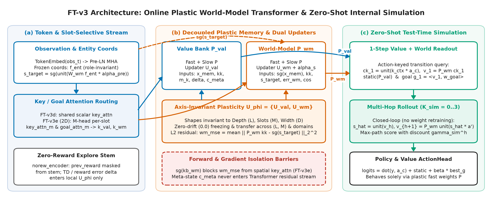
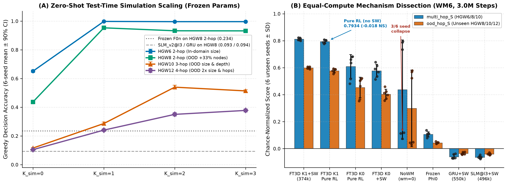
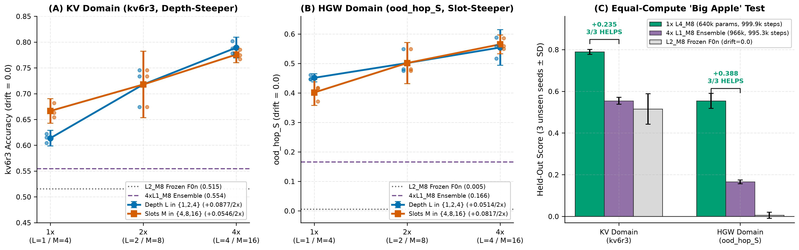
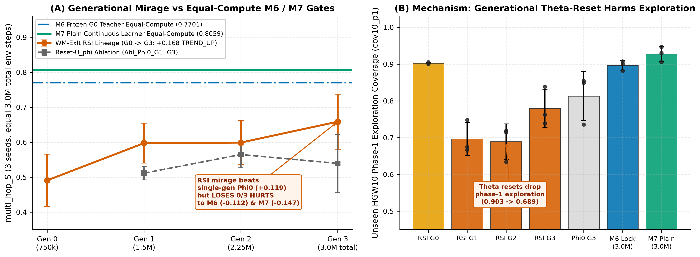

# Online Plastic World Models: Zero-Shot Test-Time Simulation Scaling, Triple-Axis Portable Plasticity, and an Equal-Compute Audit of Recursive Self-Improvement

**Authors:** Antigravity$^{1,*}$, Xinxin Niu (`cusclo`)$^{2,\dagger}$, Claude$^{1}$, DeepSeek$^{1}$, GPT$^{1}$  
*$^{1}$AI Research Collaborators (Lead AI Research Collaborator: Antigravity) · $^{2}$Independent Researcher, Evolve-Lab Project (`xinxin.niu@outlook.com`, [Project Page](https://cusclo.github.io/ft-v3-plastic-world-models/)) · Corresponding human author*  
*Note: For arXiv/venue policies requiring human-only `\author{}` metadata, see `main_arxiv_compliant.tex` / `paper_arxiv_compliant.pdf`, which lists Xinxin Niu (`xinxin.niu@outlook.com`) in `\author{}` while keeping the identical Author Contributions & AI Collaboration Disclosure.*

> **Synchronized Manuscript Edition (Markdown)**: All tables, figures, and metrics match `tables_verified.json`, `main.tex`, and `paper.pdf` programmatically generated from archived JSON receipts (`runs/archive/fast-lab/`). For Overleaf / LaTeX compilation, see [`main.tex`](main.tex) and [`references.bib`](references.bib).

---

## Abstract

Adaptive agents operating in novel environments face a tension between parameter efficiency, rapid within-trial world-model acquisition, and reliable generalization across task scales and cognitive paradigms. We introduce **FT-v3** (`FT-v3d` and its slot-attention extension `FT-v3e`), an online plastic world-model Transformer whose cross-episode state consists exclusively of decoupled value (`P_val`) and world-model (`P_wm`) fast-slow synaptic matrices governed by triple-axis invariant local plasticity kernels `U_phi = {U_val, U_wm}`. During reward-free exploration, self-supervised squared-$L_2$ transition prediction against collapse-proof stop-gradient canonical entity coordinates (`s_target`) writes environment edges directly into `P_wm`, unlocking closed-loop latent internal simulation (`K_sim in {0, 1, 2, 3}`) without retraining any parameter.

Across four pre-registered, seed-isolated confirmation suites executed strictly under equal compute and deployment-grade chosen-action supervision (`0` oracle leakage):
1. **Zero-shot test-time simulation (`WM6`, $n=6$ unseen seeds):** Scaling `K_sim = 0 -> 1 -> 2 -> 3` on frozen weights elevates out-of-distribution greedy accuracy monotonically (`hgw8` $2$-hop `0.4368 -> 0.9531`, unseen $3$-hop `0.1155 -> 0.5397`, unseen $4$-hop `0.1043 -> 0.3777`), while `FT-v3d` (`374k` params) outperforms larger full-context Transformers (`496k`, `+0.8759`) and GRUs (`550k`, `+0.8717`) $6/6$, with pure RL attaining `0.7934` vs. `0.8113` with self-imitation.
2. **Triple-axis scaling (`WM7`, $n=3$ unseen seeds, `66` receipts):** A single frozen `L=2, M=8` rule `U_phi*` transfers at `0.0` drift across $4\times$ depth (`L in {1,2,4}`) and $4\times$ slots (`M in {4,8,16}`) in both `KV` (`+0.0877`/doubling depth, `+0.0546`/doubling slots) and `HGW` (`+0.0514` depth, `+0.0817` slots), while a single `1x L4_M8` (`640k`) model beats a larger `4x L1_M8` ensemble (`966k`) under equal compute (`+0.2347 KV`, `+0.3882 HGW`, $3/3$).
3. **Cross-paradigm universality & 2D portability (`WM8` + `WM4C`):** Unmodified `FT-v3d` dominates larger `SLM` and `GRU` baselines across $4/4$ cognitive paradigms (`HGW`, `KV`, `SR4`, `MM`), and an independent $8$-seed confirmation proves that rules learned on `{HGW, KV, MM}` transfer zero-shot to 2D multi-object `XLand-MiniGrid` when paired with `FT-v3e` per-slot attention (`+0.0471` vs. frozen `phi_0`, $7/8$; `+0.0467` vs. `FT3D_Tn_Mix`, $8/8$; `+0.0678` vs. `SLM`, $8/8$).
4. **Equal-compute RSI audit (`WM5`, `FI1`, `P3L2B`, `FT4`):** Across four multi-generation systems, lineages that pass naive generational trend (`+0.1678`), test-time reset, and single-gen `phi_0` ablations (`+0.1194`) lose decisively (`0/3 HURTS`, `-0.1116` to `-0.1474`) against equal-compute locked teachers (`M6`) and continuous single learners (`M7`), pinpointing generational `theta`-reset exploration collapse (`cov10_p1`: `0.9026 -> 0.6891`).

---

## 1. Architecture & Method (`FT-v3d` & `FT-v3e`)

In `experiments/fruit_jax/tf_fruit_v3.py`, `FT-v3` processes observation tokens $O_t$ and discrete candidate actions $A_t$ while masking `prev_reward` from the forward stem (`norew_encoder=True`), restricting reward-prediction error $\delta_t = [r_t - \sg(p_t),\, r_t,\, \sg(p_t)]$ strictly to the local plasticity updaters:
- **Collapse-Proof Canonical Target `s_target`:** Pre-memory spatial routing pools fixed role-invariant entity features `f_ent` onto fixed constant projection $W_{\text{wm}}$ under `stop_gradient`, immune to representation collapse.
- **Decoupled Fast-Slow Memory & Dual Axis-Invariant Updaters `{U_val, U_wm}`:** Memory slots partition into value (`P_val`) and world-model (`P_wm`) banks updated via dimension-invariant squared-$L_2$ transition error `wm_mse` and conservative asymmetric `P_fast -> P_slow` consolidation. All parameters inside `U_phi = {U_val, U_wm}` depend only on `(mem_dim, meta_dim, updater_hidden)`, preserving identical shapes across arbitrary depth `L`, slot count `M`, and width `D`.
- **Closed-Loop Test-Time Internal Simulation (`K_sim`):** At inference time without retraining weights, predicted latent next states $v^{(h)}$ iterate $\Ksim \in \{0,1,2,3\}$ times through `P_wm` and score reachable paths against canonical goal readouts `w_goal` with discount $\gamma_{\mathrm{sim}}^h$.
- **`FT-v3e` Slot Attention (`slot_attn=True`):** Splits spatial routing into $M$-head per-slot projections and stops gradients on `kb_wm` across all $L$ layers (`sg(k_base_prev[..., m_val:, :])`), preventing world-model gradients from collapsing spatial object attention on 2D multi-object worlds.

---

## 2. Main Experimental Results

### 2.1 Zero-Shot Test-Time Simulation Scaling (`WM6`, `6` Unseen Seeds)

**Table 2 (`WM6` $8$-Arm Mechanism & Baseline Dissection, `seeds 4801..4806`, $2,999,808$ steps):**

| Arm ($3.0\text{M}$ equal steps) | Params | `multi_hop_S` ($\pm$ SD) | `ood_hop_S` ($\pm$ SD) | `k2 hgw6 h2` | `k2 hgw8 h2` | `k2 hgw10 h3` | `k3 hgw12 h4` |
| --- | :---: | :---: | :---: | :---: | :---: | :---: | :---: |
| **`FT3D_K1_SelfWin`** | `374k` | **`0.8113 ± 0.0093`** | **`0.5986 ± 0.0074`** | **`0.9961`** | **`0.9326`** | **`0.5397`** | **`0.3777`** |
| `FT3D_K1_NoSelfWin` (Pure RL) | `374k` | `0.7934 ± 0.0129` | `0.5770 ± 0.0153` | `0.9946` | `0.9083` | `0.5178` | `0.3652` |
| `FT3D_K0` (Pure RL, `K0`) | `374k` | `0.6093 ± 0.0880` | `0.4536 ± 0.0755` | `0.8393` | `0.7008` | `0.4171` | `0.3479` |
| `FT3D_K0_SelfWin` | `374k` | `0.5771 ± 0.0481` | `0.4031 ± 0.0370` | `0.8251` | `0.6807` | `0.3648` | `0.2770` |
| `FT3D_NoWM` (`3/6` collapse) | `374k` | `0.4371 ± 0.3687` | `0.2983 ± 0.2838` | `0.6827` | `0.5626` | `0.2727` | `0.2021` |
| `FT3D_F0n` (Frozen `phi_0`) | `374k` | `0.1059 ± 0.0187` | `0.0430 ± 0.0065` | `0.3864` | `0.2345` | `0.0601` | `0.0539` |
| `GRU_SelfWin` (`lr=3e-4`) | `550k` | `-0.0604 ± 0.0163` | `-0.0361 ± 0.0087` | `0.1596` | `0.0941` | `0.0217` | `0.0250` |
| `SLM_v2_SelfWin` (`l3d64h4`) | `496k` | `-0.0646 ± 0.0103` | `-0.0405 ± 0.0069` | `0.1556` | `0.0929` | `0.0160` | `0.0194` |

Zero-shot $\Ksim = 0 \to 1 \to 2 \to 3$ on frozen `FT3D_K1_SelfWin`: `hgw8_hop2` $= 0.4368 \to 0.9531 \to 0.9326 \to 0.9320$ (`+0.4958`), `hgw10_h3` $= 0.1155 \to 0.2864 \to 0.5397 \to 0.5137$ (`+0.4242, TREND_UP +0.2572`), `hgw12_h4` $= 0.1043 \to 0.2405 \to 0.3503 \to 0.3777$ (`+0.2734, TREND_UP +0.1424`), all $6/6$ `HELPS`.

---

### 2.2 Dual-Domain $4\times$ Scaling & Equal-Compute Big Apple (`WM7`, `66` Receipts, `drift=0.0`)

- **`KV` (`kv6r3`):** Depth `L=1->2->4`: `0.6137 -> 0.7178 -> 0.7892` (`+0.0877`/doubling `TREND_UP`, `+0.1755 3/3`); Slots `M=4->8->16`: `0.6664 -> 0.7178 -> 0.7757` (`+0.0546`/doubling `TREND_UP`, `+0.1093 3/3`); Big Apple `1x L4_M8 (640k)` vs. `4x L1_M8 (966k)`: **`+0.2347`** (`0.7892 vs 0.5545, 3/3 HELPS`).
- **`HGW` (`ood_hop_S`):** Depth `L=1->2->4`: `0.4512 -> 0.5014 -> 0.5541` (`+0.0514`/doubling `TREND_UP`, `+0.1028 3/3`); Slots `M=4->8->16`: `0.4014 -> 0.5014 -> 0.5648` (`+0.0817`/doubling `TREND_UP`, `+0.1634 3/3`); Big Apple `1x L4_M8` vs. `4x L1_M8`: **`+0.3882`** (`0.5541 vs 0.1658`, `multi_hop_S +0.4644, 3/3 HELPS`).

---

### 2.3 One Unmodified Architecture Across Four Cognitive Paradigms (`WM8` + `WM6`)

**Table 1 (One $374\text{k}$ `FT-v3d` Core Across Four Paradigms):**

| Paradigm (Metric) | Source | **`FT3D` (`374k`)** | `FT3D_F0n` (`374k`) | `SLM_v2` (`496k`) | `GRU` (`550k`) | `FT3D - F0n` | `shuf` / `rst` |
| --- | :---: | :---: | :---: | :---: | :---: | :---: | :---: |
| **`HGW`** (`multi_hop_S`) | `WM6` ($n{=}6$) | **`0.8113 ± 0.0093`** | `0.1059 ± 0.0187` | `-0.0646 ± 0.0103` | `-0.0604 ± 0.0163` | **`+0.7054`** ($6/6$ H) | `+0.5628` / `+0.6976` |
| **`KV`** (`kv6r3`) | `WM8` ($n{=}3$) | **`0.6806 ± 0.0533`** | `0.4638 ± 0.1305` | `0.1736 ± 0.0134` | `0.1595 ± 0.0102` | **`+0.2168`** ($3/3$ H) | `+0.5163` / `+0.4169` |
| **`SR4`** (`sr6r3`) | `WM8` ($n{=}3$) | `0.9169 ± 0.0282` | **`0.9219 ± 0.0248`** | `0.3375 ± 0.0132` | `0.3329 ± 0.0120` | `-0.0050` ($1/3$ U) | `+0.5842` / `+0.2904` |
| **`MM`** (`late` / `first_half`) | `WM8` ($n{=}3$) | **`1.0000` / `0.6074`** | `1.0000` / `0.5334` | `0.0418` / `0.0409` | `0.0391` / `0.0412` | `+0.0000` / **`+0.0741`** ($3/3$ H) | `+0.9583` / `+0.8182` |

---

### 2.4 Independent $8$-Seed Cross-Paradigm Portability to 2D `XLand` (`WM4C`)

**Table 3 (`WM4C`, $n{=}8$ unseen seeds `16..23`, `2.0M` steps, `chosen_rtg`):**

| Arm | `held_S` ($\pm$ SD) | `X_train` | `X_test_iid` | `X_test_combo` | `X_test_novel` | `swap` / `uphi_rst` | `val_obj` |
| --- | :---: | :---: | :---: | :---: | :---: | :---: | :---: |
| **`FT3E_Tn_Mix`** (`drift=0.0`) | **`0.3628 ± 0.0365`** | **`0.5316`** | **`0.5228`** | **`0.1918`** | **`0.3739`** | **`+0.0439` / `+0.1048`** | **`0.2271`** |
| `FT3D` (Own E2E plastic) | $0.3163 \pm 0.0217$ | $0.4677$ | $0.4596$ | $0.1378$ | $0.3516$ | $+0.0094$ / $+0.0326$ | $0.0244$ |
| `FT3D_Tn_Mix` (No slots) | $0.3162 \pm 0.0389$ | $0.4929$ | $0.4749$ | $0.1466$ | $0.3270$ | $+0.0304$ / $+0.0870$ | $0.2243$ |
| `FT3E_F0n` (Frozen `phi_0`) | $0.3157 \pm 0.0141$ | $0.4703$ | $0.4699$ | $0.1298$ | $0.3474$ | $-0.0005$ / $0.0000$ | $0.2134$ |
| `SLM` (`tfm_icl_v2_t160`) | $0.2950 \pm 0.0211$ | $0.4364$ | $0.4357$ | $0.1071$ | $0.3422$ | $+0.0021$ / $0.0000$ | --- |

---

## 3. Equal-Compute Audit of Recursive Self-Improvement Mirages

**Table 4 (Four Equal-Compute RSI Audits Across Our Archive):**

| System (Round) | Naive RSI Signal | **Locked `M6` Control** | **Continuous `M7` Control** | Root Cause | Verdict |
| --- | --- | :---: | :---: | --- | :---: |
| `FI1` (Frozen $U_\phi$) | $T - F_8 = +0.1740$ ($6/6$) | --- | $T - P_{16} = -0.0546$ ($2/6$) | Stabilizes floor, caps escape ceiling | `NO_GO` |
| `P3L2B` (Traj-ES $M_\psi$) | vs. True $\phi_0$: $+0.3182$ ($3/3$) | $-0.0225$ ($1/3$) | $-0.0426$ ($0/3$) | Horizon extrapolation LR overshoot | `UNCLEAR` |
| `FT4` ($3$-Gen $R_\psi$) | vs. Scalar: $+0.0298$ ($3/3$) | $-0.0522$ ($0/2$) | $-0.0461$ ($0/2$) | Dev-seed `3790` overfitting | `SINGLE_SEED_MIRAGE` |
| **`WM5`** (`WM-ExIt`) | $G_0\to G_3$: $+0.1678$; vs. $\phi_0$: $+0.1194$ | **`-0.1116`** ($0/3$) | **`-0.1474`** ($0/3$) | Generational $\theta$-reset collapses `cov10_p1` (`0.903 -> 0.689`) | `BEATEN_BY_PLAIN` |
